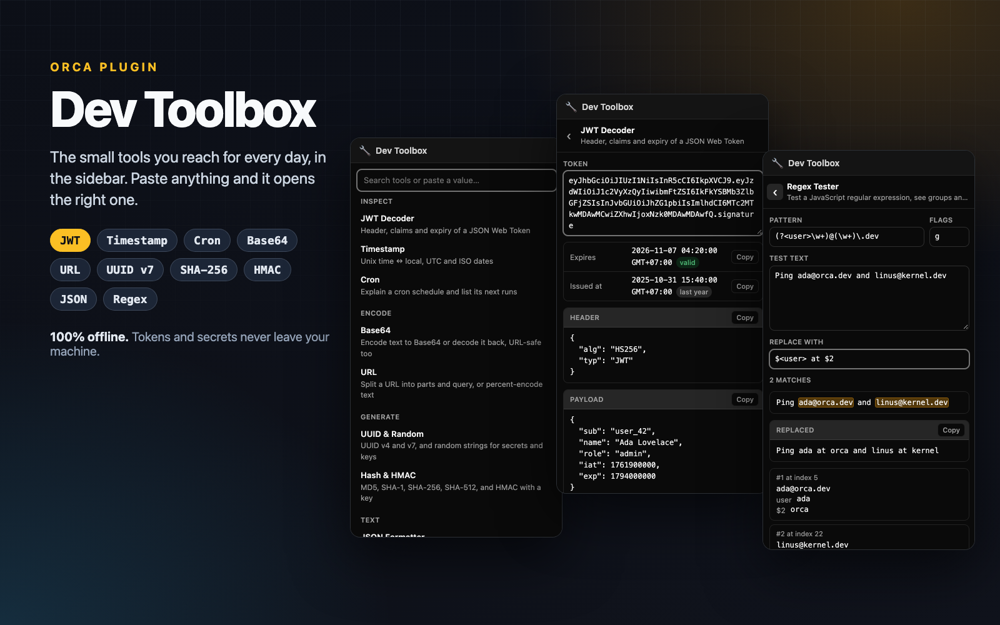

# Dev Toolbox for Orca

The small tools you reach for every day, in [Orca](https://www.onorca.dev)'s right sidebar.
Everything runs inside Orca's sandboxed panel with no network access, so tokens, secrets and
payloads you paste never leave your machine.

## Tools

| Group | Tool | What it does |
| --- | --- | --- |
| Inspect | **JWT Decoder** | Header and payload of a JSON Web Token, with `exp`, `iat` and `nbf` as local times and whether it has expired. Accepts `Bearer …`. The signature is not verified. |
| Inspect | **Timestamp** | Unix seconds, milliseconds, microseconds or nanoseconds (told apart by length), or any date, shown as local time, UTC, ISO 8601, relative time and both Unix forms. |
| Inspect | **Cron** | A five-field cron expression in plain English, with its next five runs. Names (`MON`, `JAN`), ranges, steps and `@daily`-style shortcuts. |
| Encode | **Base64** | Encode UTF-8 text, standard or URL-safe; decode either alphabet, with binary shown as hex. |
| Encode | **URL** | Split a URL into scheme, host, port, path, fragment and decoded query parameters, or percent-encode and decode text. |
| Generate | **UUID & Random** | UUID v4, time-ordered UUID v7, and random strings in four alphabets, from the system's secure random generator. Paste a v7 to read its creation time. |
| Generate | **Hash & HMAC** | MD5, SHA-1, SHA-256 and SHA-512 of text, in hex or Base64; with a key, the HMAC of each, as webhooks are signed. |
| Text | **JSON Formatter** | Validate with the line and column of any error, pretty-print with 2 or 4 spaces or tabs, minify, sort keys. |
| Text | **Regex Tester** | JavaScript regular expressions with highlighted matches, numbered and named groups, and replacement. |

## Use

Open the **Dev Toolbox** panel (wrench icon) in the right sidebar.

- **Paste anything into the search box** and the right tool opens with it filled in: a JWT, a
  timestamp or date, JSON, a URL, a cron expression, Base64 or a UUID.
- **Or type** to search tools by name or keyword (`sha256`, `epoch`, `prettify`…); Enter opens
  the first match, ↓ moves through the list.
- **Esc** returns to the list. Each tool keeps what you typed while you switch between them.
- **Copy** buttons sit next to every result.

Requires Orca 1.4.245 or later.

## Develop

Settings → Plugins → **Development folders…** → add this folder. The panel is built from
`build/src`; see [build/README.md](build/README.md) for building, testing and adding a tool.

## Licence

MIT. No third-party code is bundled.
